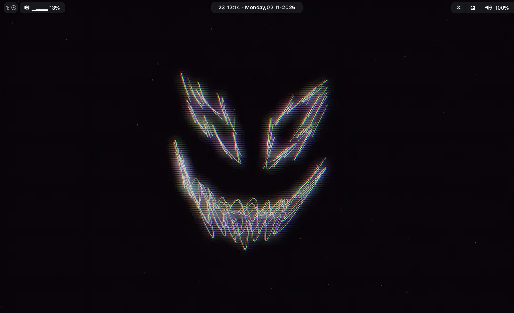

<div align="center">

# ⌘ waybar-config

**macOS-inspired floating status bar for [Hyprland](https://hyprland.org), built on [Waybar](https://github.com/Alexays/Waybar)**

[](https://github.com/Alexays/Waybar)
[](https://hyprland.org)
[](LICENSE)
[](style.css)

</div>

---

<p align="center">
  
</p>

<p align="center">
  
</p>

##  About

A minimal, self-contained Waybar setup with a **macOS "solid" look**: floating rounded pills, a
monolithic group of modules on the right, and a live clock in the center. Everything is driven by
plain JSONC + CSS — no frameworks, no build step.

### Features

-  **Floating pills** — every module is a rounded, translucent card with a subtle border and shadow
-  **Seamless right group** — bluetooth / network / audio / backlight / battery are merged into one
  monolith with only the outer corners rounded
-  **Live clock** — seconds-precision center module with date and weekday
-  **CPU sparkline** — usage plus a block-graph icon that grows with the load
-  **Pomodoro timer** — start / pause / reset straight from the bar
-  **Battery states** — warning at 30 %, critical at 15 %, charging highlighted in green
-  **Click actions** — Bluetooth manager, network editor, volume control, `htop`, screen lock

##  Structure

```text
waybar-config/
├── config               # bar layout & module settings (JSONC)
├── style.css            # the macOS "solid" theme
├── macchiato.css        # Catppuccin Macchiato palette (GTK @define-color)
├── scripts/
│   └── uptime.sh        # custom "uptime" module
├── archive/             # legacy configs (pywal / ml4w theme), kept for reference
│   ├── config.jsonc
│   ├── modules.json
│   ├── config_old.jsonc
│   └── style_old.css
└── assets/              # screenshots used in this README
```

##  Dependencies

| Package | Why |
| --- | --- |
| [waybar](https://github.com/Alexays/Waybar) ≥ 0.15 | the bar itself |
| [hyprland](https://hyprland.org) | `hyprland/workspaces` module |
| [Nerd Font](https://www.nerdfonts.com/) (e.g. *Noto Sans Nerd Font*) | icons; *SF Pro* / *Inter* used as UI fonts |
| [blueman](https://github.com/blueman-project/blueman) | `bluetooth` click action |
| [network-manager-applet](https://gitlab.gnome.org/GNOME/network-manager-applet) | `network` click action |
| [pavucontrol](https://github.com/pulseaudio/pavucontrol) | `pulseaudio` click action |
| [waybar-module-pomodoro](https://github.com/kbajnok/waybar-module-pomodoro) |  module |
| [playerctl](https://github.com/altdesktop/playerctl) | optional `custom/music` module |

> Only `waybar`, `hyprland` and a Nerd Font are strictly required — everything else powers a click
> action or an optional module.

##  Install

### Option A — clone straight into your config dir

```bash
git clone https://github.com/zeuthe/waybar-config.git ~/.config/waybar
```

### Option B — use the install script (backs up your current config)

```bash
git clone https://github.com/zeuthe/waybar-config.git
cd waybar-config
./install.sh
```

Your existing `~/.config/waybar` is moved to `~/.config/waybar.bak.<timestamp>` first, so nothing
gets lost.

### Restart the bar

```bash
killall waybar && waybar &
```

##  Customization

- **Colors** — edit `#waybar` and the module selectors in [`style.css`](style.css).
  The palette in [`macchiato.css`](macchiato.css) (Catppuccin Macchiato) is handy as a reference.
- **Modules** — add or remove entries in the `modules-left` / `modules-center` / `modules-right`
  arrays of [`config`](config), then define the module settings below them.
- **Layout** — `position` (`top` / `bottom` / …), margins, `layer` and `spacing` are all set at the
  top of [`config`](config).

### Included modules

| Module | Position | Notes |
| --- | --- | --- |
| `hyprland/workspaces` | left | `name: icon` format |
| `custom/uptime` | left | runs `scripts/uptime.sh` |
| `cpu` | left | usage + block sparkline, click → `htop` |
| `clock` | center | `%H:%M:%S - %A, %d %m-%Y` |
| `custom/pomodoro` | right | work / break timer |
| `bluetooth` | right | click → `blueman-manager` |
| `network` | right | wifi / ethernet / disconnected icons |
| `pulseaudio` | right | click → `pavucontrol` |
| `backlight` | right | 7-step brightness icons |
| `battery` | right | states: warning 30 %, critical 15 % |

##  Archive

`archive/` contains an earlier setup: a **pywal**-driven theme with the module pack from
[ml4w / Stephan Raabe](https://github.com/StephanRaabe) (`modules.json`, `config.jsonc`).
It is not loaded by the current config, but is kept in case you want a fully dynamic,
wallpaper-based color scheme.

##  License

Released under the [MIT License](LICENSE) — feel free to copy, tweak and ship your own version.

---

<div align="center">

Made with ☕ and CSS

</div>
