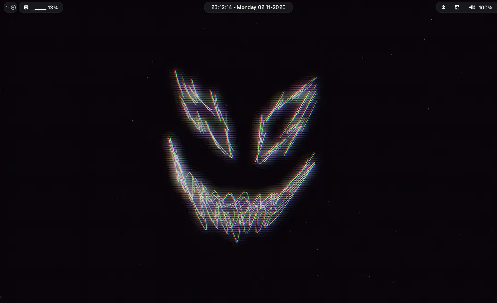

<div align="center">

# ⌘ waybar-config

**Плавающая панель в стиле macOS для [Hyprland](https://hyprland.org) на основе [Waybar](https://github.com/Alexays/Waybar)**

[](https://github.com/Alexays/Waybar)
[](https://hyprland.org)
[](LICENSE)
[](style.css)

**[English](README.md)** · Русский

</div>

---

<p align="center">
  
</p>

<p align="center">
  
</p>

## ✨  проекте

Самодостаточная настройка Waybar в стиле **macOS «solid»**: плавающие скруглённые «пилюли»,
слитная группа модулей справа и живые часы по центру. Всё на чистом JSONC + CSS — без
фреймворков и сборки.

### Возможности

-  **Плавающие пилюли** — каждый модуль это полупрозрачная карточка с рамкой и тенью
-  **Слитная группа справа** — bluetooth / сеть / звук / подсветка / батарея объединены в один
  монолит со скруглением только по внешним углам
-  **Живые часы** — время с секундами, дата и день недели по центру
- **CPU-спарклайн** — загрузка плюс блочный график
-  **Помодор** — старт / пауза / сброс прямо из панели
-  **Состояния батареи** — предупреждение на 30 %, критично на 15 %, зарядка зелёным
- 🖱**Клики** — менеджер Bluetooth, настройки сети, громкость, `htop`, блокировка экрана

##  Структура

```text
waybar-config/
├── config               # раскладка панели и модули (JSONC)
├── style.css            # тема macOS «solid»
├── macchiato.css        # палитра Catppuccin Macchiato (GTK @define-color)
├── scripts/
│   └── uptime.sh        # кастомный модуль аптайма
├── archive/             # старые конфиги (pywal / ml4w), для справки
│   ├── config.jsonc
│   ├── modules.json
│   ├── config_old.jsonc
│   └── style_old.css
└── assets/              # скриншоты для README
```

##  Зависимости

| Пакет | Зачем |
| --- | --- |
| [waybar](https://github.com/Alexays/Waybar) ≥ 0.15 | сама панель |
| [hyprland](https://hyprland.org) | модуль `hyprland/workspaces` |
| [Nerd Font](https://www.nerdfonts.com/) (например *Noto Sans Nerd Font*) | иконки; UI-шрифты *SF Pro* / *Inter* |
| [blueman](https://github.com/blueman-project/blueman) | клик по `bluetooth` |
| [network-manager-applet](https://gitlab.gnome.org/GNOME/network-manager-applet) | клик по `network` |
| [pavucontrol](https://github.com/pulseaudio/pavucontrol) | клик по `pulseaudio` |
| [waybar-module-pomodoro](https://github.com/kbajnok/waybar-module-pomodoro) | 🍅 модуль |
| [playerctl](https://github.com/altdesktop/playerctl) | опциональный `custom/music` |

> Обязательны только `waybar`, `hyprland` и Nerd Font — остальное нужно для кликов и
> опциональных модулей.

##  Установка

### Вариант A — клонировать сразу в конфиг

```bash
git clone https://github.com/zeuthe/waybar-config.git ~/.config/waybar
```

### Вариант B — установочный скрипт (сначала бэкап)

```bash
git clone https://github.com/zeuthe/waybar-config.git
cd waybar-config
./install.sh
```

Текущий `~/.config/waybar` переименуется в `~/.config/waybar.bak.<timestamp>` — ничего не
потеряется.

### Перезапуск панели

```bash
killall waybar && waybar &
```

##  Настройка

- **Цвета** — правьте `#waybar` и селекторы модулей в [`style.css`](style.css).
  Палитра в [`macchiato.css`](macchiato.css) (Catppuccin Macchiato) удобна как справочник.
- **Модули** — добавляйте/убирайте записи в массивах `modules-left` / `modules-center` /
  `modules-right` в [`config`](config), а настройки модуля описывайте ниже.
- **Раскладка** — `position`, отступы, `layer` и `spacing` задаются в начале [`config`](config).

### Модули

| Модуль | Позиция | Примечание |
| --- | --- | --- |
| `hyprland/workspaces` | слева | формат `name: icon` |
| `custom/uptime` | слева | запускает `scripts/uptime.sh` |
| `cpu` | слева | загрузка + спарклайн, клик → `htop` |
| `clock` | центр | `%H:%M:%S - %A, %d %m-%Y` |
| `custom/pomodoro` | справа | таймер работы / перерыва |
| `bluetooth` | справа | клик → `blueman-manager` |
| `network` | справа | иконки wifi / ethernet / нет связи |
| `pulseaudio` | справа | клик → `pavucontrol` |
| `backlight` | справа | 7 иконок яркости |
| `battery` | справа | warning 30 %, critical 15 % |

## Архив

В `archive/` лежит старая сборка: тема на **pywal** и набор модулей от
[ml4w / Stephan Raabe](https://github.com/StephanRaabe) (`modules.json`, `config.jsonc`).
Текущий конфиг их не подключает, но они сохранены на случай, если захотите полностью динамические
цвета из обоев.

##  Лицензия

[MIT License](LICENSE) — копируйте, переписывайте под себя и выкладывайте свои версии.

---

<div align:center>

Сделано на ☕ и CSS

</div>
